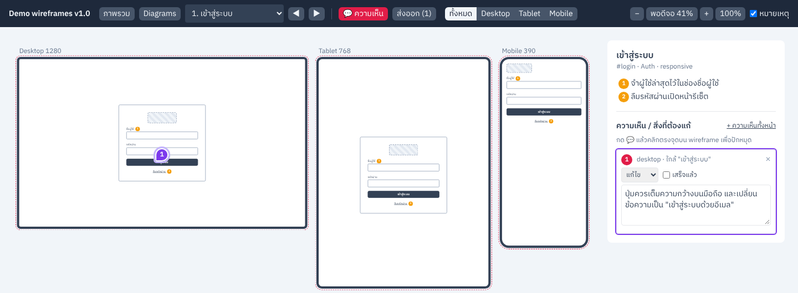
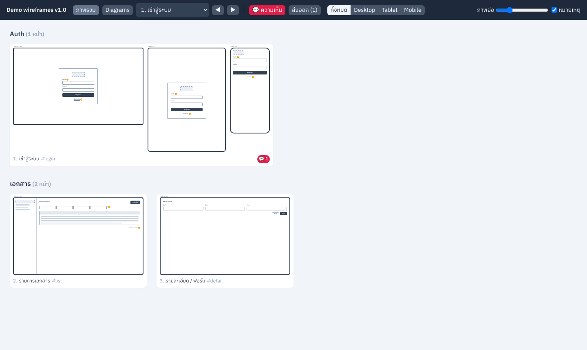
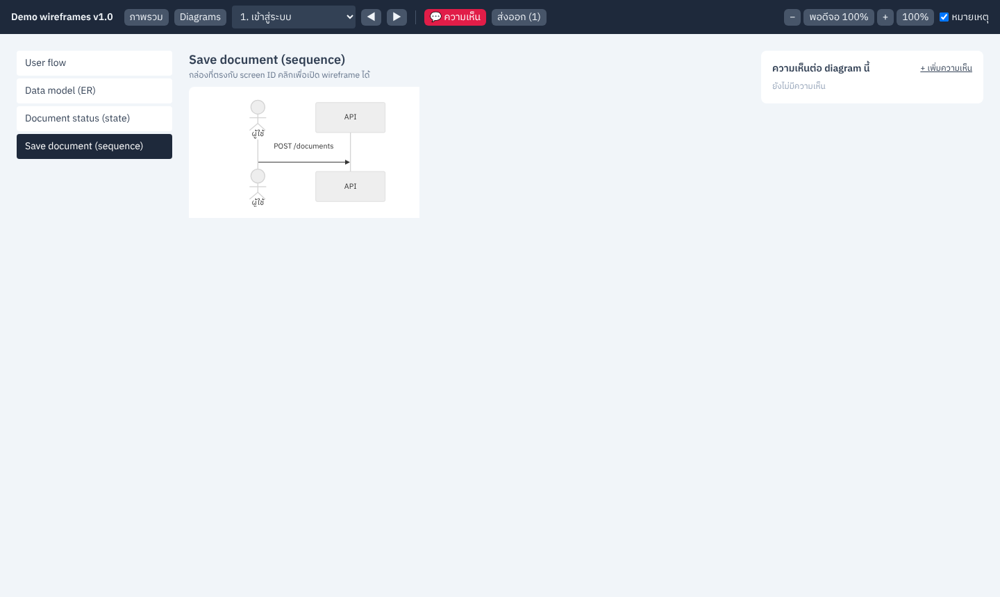
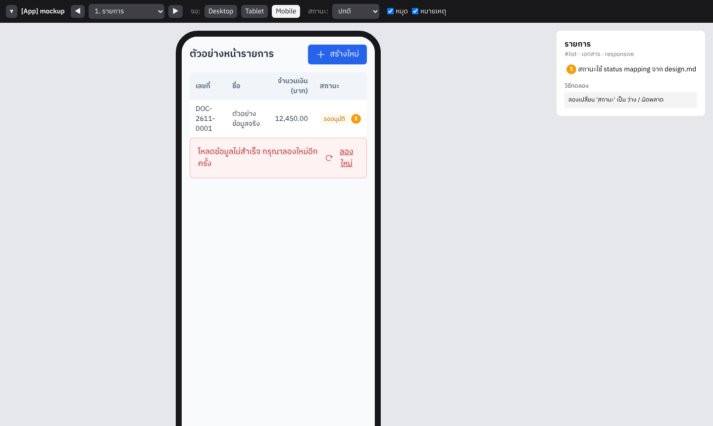
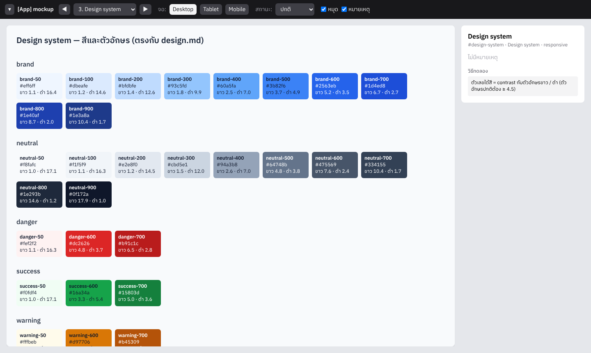

<p align="center">
  
</p>

<h1 align="center">Design Kit — a skill</h1>

<p align="center">
  Describe an app. Get a complete, reviewable design project: wireframes of every screen, a clickable mockup,
  a design system, dev diagrams and a UX spec — all kept in sync whenever you ask for a change.
</p>

<p align="center">
  <a href="README.th.md">ภาษาไทย</a> ·
  <a href="#install">Install</a> ·
  <a href="#other-ai-agents">Other agents</a> ·
  <a href="#usage">Usage</a> ·
  <a href="#what-you-get">What you get</a> ·
  <a href="#review-workflow">Review workflow</a>
</p>



## Why

Asking an AI to "design a screen" usually gives you one pretty page that doesn't match the next one, emoji for icons, no empty or error states, and nothing a developer can build from. This skill makes the AI work like a designer handing off to a dev team:

- **Every screen**, not just the happy path — including login, 403/404, empty states, session expired.
- **One source of truth** (`design.md`) for colors, typography and icons, checked for WCAG AA contrast.
- **Low-fi wireframes first**, then a hi-fi mockup, so structure is agreed before colors.
- **Dev diagrams** — ER, state, sequence, API contract — that match the screens.
- **Changes propagate**: "add a phone field" updates the wireframe, mockup, spec, ER diagram and API table together.
- **Verified**: a script checks that every file agrees before anything is handed over.

Works for internal ERP/back-office tools, customer-facing web apps and mobile apps. Thai-first defaults (IBM Plex Sans Thai, Thai line-height rules, THB and dd/MM/yyyy sample data), English works the same.

## Install

### Claude Code — plugin marketplace (recommended)

Inside a Claude Code session:

```
/plugin marketplace add KPV2004/design-kit
/plugin install design-kit@design-kit
```

Or from your shell:

```bash
claude plugin marketplace add KPV2004/design-kit
claude plugin install design-kit@design-kit
```

Update later with:

```bash
claude plugin marketplace update design-kit
claude plugin update design-kit@design-kit
```

Remove with `claude plugin uninstall design-kit@design-kit`.

### Claude Code — manual copy

```bash
git clone https://github.com/KPV2004/design-kit.git
cp -r design-kit/skills/design-kit ~/.claude/skills/design-kit
```

Use `<your-project>/.claude/skills/` instead of `~/.claude/skills/` to install it for one repository only.

### Claude.ai (web, desktop, mobile)

1. Download `design-kit.zip` from the [latest release](https://github.com/KPV2004/design-kit/releases/latest)
   (or build it yourself: `./tools/build-skill.sh` → `dist/design-kit.zip`).
2. Make sure **Code execution and file creation** is enabled in Settings → Capabilities.
3. Go to **Customize → Skills**, click **+** → **Create skill** → **Upload a skill**, and choose the zip.

Skills you enable on claude.ai also sync to Claude Code when you sign in with the same account. See Anthropic's guide: [Use skills in Claude](https://support.claude.com/en/articles/12512180).

### Other AI agents

The skill follows the open [Agent Skills](https://agentskills.io) format (a folder with a `SKILL.md`), so any agent that supports skills can use it.

**Easiest: the `skills` CLI.** It detects which agents you have installed and copies the skill to the right folder for each:

```bash
npx skills add KPV2004/design-kit
```

Pick agents explicitly with `-a`, for example `npx skills add KPV2004/design-kit -a codex -a cursor`.

**Manual copy.** Clone once, then copy `skills/design-kit` into your agent's skills folder:

```bash
git clone https://github.com/KPV2004/design-kit.git
cp -r design-kit/skills/design-kit ~/.agents/skills/design-kit
```

| Agent | Global (all projects) | One project only |
|---|---|---|
| OpenAI Codex CLI | `~/.agents/skills/` | `.agents/skills/` |
| Gemini CLI | `~/.gemini/skills/` | `.gemini/skills/` |
| Cursor | `~/.cursor/skills/` | `.cursor/skills/` |
| GitHub Copilot (VS Code / CLI) | `~/.copilot/skills/` | `.github/skills/` |
| Other agents | see the agent's docs | `.agents/skills/` works for many |

Folder names change between agent versions, so check your agent's docs if the skill doesn't show up. Restart the agent after copying.

**Chat apps without skill support** (ChatGPT, Gemini web, etc.): download `design-kit.zip` from the [latest release](https://github.com/KPV2004/design-kit/releases/latest), upload it to the chat (or a project/custom GPT), and say *"Follow SKILL.md in this zip to design …"*. The wireframes and mockup need a tool that can create files, and `verify.py` needs one that can run Python — without them you get the design text only.

The instructions were written and tested with Claude. Other models can follow them, but results vary — always open the generated `wireframes.html` and `mockup.html` to check.

### Requirements

- Python 3.9+ (for the helper scripts the skill runs).
- Optional: `pip install playwright && playwright install chromium` — enables browser checks in `verify.py` (JS errors, icon names, Mermaid syntax, annotation visibility). Already available on claude.ai.
- An internet connection when opening the HTML files (Tailwind, fonts, icons and Mermaid load from CDNs).

## Usage

The skill triggers on its own when you ask for design work. Examples:

```
Design a purchase-order approval system for a factory: list, detail, approve/reject, dashboard.
Users are office staff who use Dynamics AX all day.
```

```
ออกแบบแอปจดรายรับรายจ่ายบนมือถือ มีหน้าบันทึก สรุปรายเดือน และตั้งงบประมาณ
```

```
Wireframe a customer self-service portal: sign up, login, view invoices, raise a ticket.
```

For apps with more than ~8 screens, Claude first sends you the screen inventory, user flow, palette and icon set to confirm — so it doesn't build 20 screens on a wrong assumption. Then it builds everything and runs the checks.

To change something, just say it: *"เปลี่ยนสีหลักเป็นเขียว"*, *"add a Tablet layout to the list screen"*, *"remove the dashboard"*. Claude edits every affected file and bumps the version.

In Claude Code you can also invoke it explicitly: `/design-kit:design-kit` when installed as a plugin, `/design-kit` when copied manually.

## What you get

Each design is a self-contained folder:

```
<app>-design/
├── AGENTS.md          AI entry point — file roles, editing rules, commands (CLAUDE.md imports it)
├── design.md          colors, typography, icons, components, screen inventory, changelog
├── ux-spec.md         behavior, validation + exact error text, diagrams (Mermaid), API contract, risks
├── wireframes.html    every screen, low-fi — open in a browser
├── mockup.html        hi-fi clickable mockup — open in a browser
├── _engine/           shared viewer code (toolbar, zoom, comments, device frames)
├── _tools/            verify.py · sync_diagrams.py · export_tokens.py
├── tokens/            tokens.css · tailwind.config.js · tokens.json for developers
└── feedback/          exported review comments
```

Open `wireframes.html` or `mockup.html` from inside the folder — they need `_engine/` next to them.

### Wireframes

- Overview of all screens grouped by module, or one screen at a time.
- **Desktop / Tablet / Mobile / All** filter (key `D`), frames side by side.
- **Zoom** — `−` `+`, fit, 100%, Ctrl/⌘ + scroll or pinch; **Space + drag** to pan.
- **Diagrams page** — user flow (boxes link to screens), ER, state and sequence diagrams.





### Mockup

- Review shell with **Desktop / Tablet / Mobile** preview — the real Tailwind breakpoints respond.
- State switcher (normal / empty / loading / error), notes sidebar explaining each numbered marker.
- **Design system page** — every color with its contrast ratio, type scale, buttons, and the icon set.

| Mobile preview | Design system |
|---|---|
|  |  |

### Design choices that keep it from looking AI-generated

- No emoji as icons; one icon set chosen for the users (Fluent for Office/Dynamics users, Phosphor or Tabler elsewhere — not Lucide by default).
- Icons support labels instead of decorating every heading; no sparkles, no pastel icon-card grids.
- Realistic content in the user's language instead of lorem ipsum.

## Review workflow

1. Open `wireframes.html`, press **💬** (or `C`) and click any spot to pin a comment — choose *edit / add / remove / question*.
2. Press **ส่งออก (Export)** → copy or download the markdown.
3. Paste it to Claude (or drop it in `feedback/` and ask Claude Code to apply it).

Claude locates each pinned element, applies the change to every affected file, answers the questions, and reports item by item. Comments are stored in your browser per file — export before moving or renaming the folder.

## Repository layout

```
.claude-plugin/
  plugin.json            plugin manifest
  marketplace.json       makes this repo installable with /plugin marketplace add
  icon.png
skills/design-kit/   the skill (this is what gets installed)
  SKILL.md               workflow instructions for Claude
  references/            color, icons, enterprise/web/mobile patterns, dev diagrams, accessibility
  assets/project/        the project template (content files + _engine/)
  scripts/               verify.py, sync_diagrams.py, export_tokens.py
tools/build-skill.sh     builds dist/design-kit.zip for claude.ai
.github/workflows/       release: tag v* → zip attached to a GitHub Release
```

## Contributing

Issues and pull requests are welcome. Publishing your own fork? Run `./tools/set-owner.sh <github-user> "<Your Name>"` once to fill in the install links and manifests.

Before opening a PR:

```bash
claude plugin validate .            # manifest + marketplace
./tools/build-skill.sh              # zip builds cleanly
```

If you change `_engine/`, open `skills/design-kit/assets/project/wireframes.html` and `mockup.html` in a browser and check there are no console errors. To release, bump `version` in `.claude-plugin/plugin.json`, update `CHANGELOG.md`, and push a tag `vX.Y.Z` — the workflow checks the tag matches and publishes the zip.

## License

[MIT](LICENSE)
