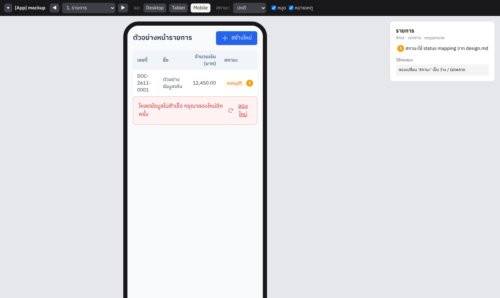
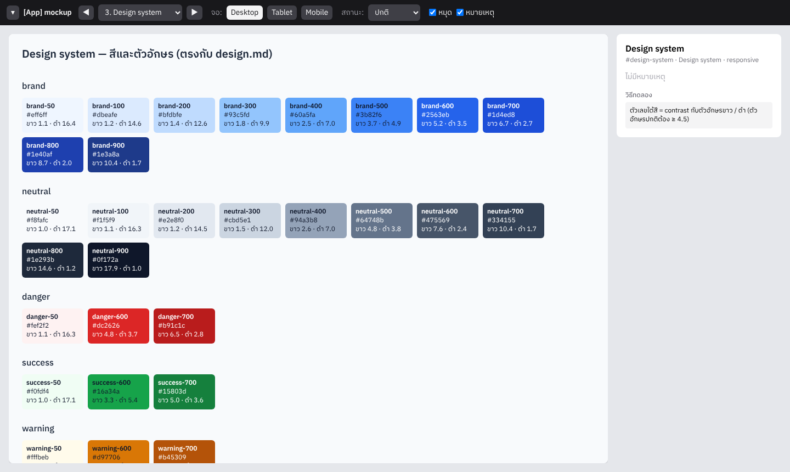

<p align="center">
  
</p>

<h1 align="center">Design Kit — skill สำหรับ Claude</h1>

<p align="center">
  เล่าว่าจะทำแอปอะไร แล้วได้โปรเจกต์ออกแบบที่รีวิวได้ครบชุด: wireframe ทุกหน้า, mockup ที่คลิกได้,
  design system, diagram สำหรับ dev และ UX spec — แก้อะไรก็อัปเดตทุกไฟล์ให้ตรงกัน
</p>

<p align="center">
  <a href="README.md">English</a> ·
  <a href="#ติดตั้ง">ติดตั้ง</a> ·
  <a href="#วิธีใช้">วิธีใช้</a> ·
  <a href="#สิ่งที่ได้">สิ่งที่ได้</a> ·
  <a href="#ขั้นตอนรีวิว">ขั้นตอนรีวิว</a>
</p>


## ทำไมต้องใช้

ถ้าสั่ง AI ว่า "ออกแบบหน้าจอให้หน่อย" ส่วนใหญ่จะได้หน้าสวย ๆ หน้าเดียวที่ไม่เข้าชุดกับหน้าอื่น ใช้ emoji แทน icon ไม่มีหน้าว่างหรือหน้า error และ dev เอาไปทำต่อไม่ได้ skill นี้ทำให้ Claude ทำงานเหมือนนักออกแบบที่ส่งงานให้ทีม dev:

- **ครบทุกหน้า** ไม่ใช่แค่ทางที่สำเร็จ รวมถึง login, 403/404, หน้าว่าง, session หมดอายุ
- **มีต้นฉบับเดียว** (`design.md`) สำหรับสี ตัวอักษร และ icon พร้อมตรวจ contrast ตาม WCAG AA
- **ทำ wireframe ก่อน** แล้วค่อยทำ mockup จริง ตกลงโครงสร้างกันก่อนค่อยคุยเรื่องสี
- **มี diagram สำหรับ dev** ทั้ง ER, state, sequence และ API contract ที่ตรงกับหน้าจอ
- **แก้จุดเดียว อัปเดตทุกที่** เช่น "เพิ่มช่องเบอร์โทร" จะแก้ wireframe, mockup, spec, ER และตาราง API พร้อมกัน
- **ตรวจก่อนส่งงาน** มีสคริปต์เช็กว่าทุกไฟล์ตรงกันก่อนส่งมอบ

ใช้ได้กับระบบภายในแบบ ERP / back-office, เว็บแอปสำหรับลูกค้า และแอปมือถือ ค่าเริ่มต้นเหมาะกับภาษาไทย (ฟอนต์ IBM Plex Sans Thai, ระยะบรรทัดสำหรับวรรณยุกต์, ข้อมูลตัวอย่างเป็นบาทและ วว/ดด/ปปปป) ใช้ภาษาอังกฤษก็ได้เหมือนกัน

## ติดตั้ง

### Claude Code — ผ่าน plugin marketplace (แนะนำ)

ใน session ของ Claude Code:

```
/plugin marketplace add KPV2004/design-kit
/plugin install design-kit@design-kit
```

หรือจาก terminal:

```bash
claude plugin marketplace add KPV2004/design-kit
claude plugin install design-kit@design-kit
```

อัปเดตเป็นเวอร์ชันใหม่:

```bash
claude plugin marketplace update design-kit
claude plugin update design-kit@design-kit
```

ถอนการติดตั้ง: `claude plugin uninstall design-kit@design-kit`

### Claude Code — copy เอง

```bash
git clone https://github.com/KPV2004/design-kit.git
cp -r design-kit/skills/design-kit ~/.claude/skills/design-kit
```

ถ้าต้องการใช้เฉพาะโปรเจกต์เดียว ให้ copy ไปที่ `<โปรเจกต์>/.claude/skills/` แทน

### Claude.ai (เว็บ, desktop, มือถือ)

1. ดาวน์โหลด `design-kit.zip` จาก [release ล่าสุด](https://github.com/KPV2004/design-kit/releases/latest)
   (หรือสร้างเอง: `./tools/build-skill.sh` จะได้ `dist/design-kit.zip`)
2. เปิด **Code execution and file creation** ใน Settings → Capabilities
3. ไปที่ **Customize → Skills** กด **+** → **Create skill** → **Upload a skill** แล้วเลือกไฟล์ zip

skill ที่เปิดใช้บน claude.ai จะ sync ไปที่ Claude Code ด้วยเมื่อ login บัญชีเดียวกัน ดูคู่มือของ Anthropic: [Use skills in Claude](https://support.claude.com/en/articles/12512180)

### สิ่งที่ต้องมี

- Python 3.9 ขึ้นไป สำหรับสคริปต์ที่ skill ใช้
- ไม่บังคับ: `pip install playwright && playwright install chromium` เพื่อให้ `verify.py` ตรวจในเบราว์เซอร์ได้ (JS error, ชื่อ icon, syntax ของ Mermaid, หมุดที่มองไม่เห็น) บน claude.ai มีให้อยู่แล้ว
- อินเทอร์เน็ตตอนเปิดไฟล์ HTML (Tailwind, ฟอนต์, icon และ Mermaid โหลดจาก CDN)

## วิธีใช้

skill จะทำงานเองเมื่อขอให้ช่วยออกแบบ ตัวอย่าง:

```
ออกแบบระบบอนุมัติใบสั่งซื้อสำหรับโรงงาน มีหน้ารายการ รายละเอียด อนุมัติ/ไม่อนุมัติ และ dashboard
ผู้ใช้เป็นพนักงานออฟฟิศที่ใช้ Dynamics AX ทั้งวัน
```

```
ออกแบบแอปจดรายรับรายจ่ายบนมือถือ มีหน้าบันทึก สรุปรายเดือน และตั้งงบประมาณ
```

```
ทำ wireframe portal ให้ลูกค้าใช้เอง: สมัครสมาชิก, login, ดูใบแจ้งหนี้, แจ้งปัญหา
```

ถ้าแอปมีเกินประมาณ 8 หน้า Claude จะส่งรายการหน้าจอ, user flow, ชุดสี และชุด icon ให้ยืนยันก่อน จะได้ไม่ต้องสร้าง 20 หน้าจากสมมติฐานที่ผิด จากนั้นจึงสร้างทั้งหมดและรันการตรวจ

อยากแก้อะไรก็บอกได้เลย เช่น *"เปลี่ยนสีหลักเป็นเขียว"*, *"เพิ่มแบบ Tablet ให้หน้ารายการ"*, *"ตัดหน้า dashboard ออก"* Claude จะแก้ทุกไฟล์ที่เกี่ยวข้องและเพิ่มเลขเวอร์ชันให้

ใน Claude Code เรียกใช้ตรง ๆ ได้ด้วย: `/design-kit:design-kit` ถ้าติดตั้งแบบ plugin หรือ `/design-kit` ถ้า copy เอง

## สิ่งที่ได้

งานแต่ละชิ้นเป็นโฟลเดอร์เดียวที่ใช้ได้ในตัว:

```
<app>-design/
├── AGENTS.md          ให้ AI อ่านก่อน — หน้าที่ของแต่ละไฟล์ กฎการแก้ คำสั่ง (CLAUDE.md โหลดไฟล์นี้)
├── design.md          สี ตัวอักษร icon component รายการหน้าจอ changelog
├── ux-spec.md         พฤติกรรม validation ข้อความ error จริง diagram (Mermaid) API contract ความเสี่ยง
├── wireframes.html    ทุกหน้าแบบ low-fi — เปิดในเบราว์เซอร์
├── mockup.html        mockup แบบ hi-fi ที่คลิกได้ — เปิดในเบราว์เซอร์
├── _engine/           โค้ดตัวแสดงผลที่ใช้ร่วมกัน (toolbar, zoom, ความเห็น, กรอบอุปกรณ์)
├── _tools/            verify.py · sync_diagrams.py · export_tokens.py
├── tokens/            tokens.css · tailwind.config.js · tokens.json สำหรับ dev
└── feedback/          ความเห็นที่ส่งออกจาก wireframe
```

ต้องเปิด `wireframes.html` หรือ `mockup.html` จากในโฟลเดอร์ เพราะต้องใช้ `_engine/` ที่อยู่ข้างกัน

### Wireframe

- ดูภาพรวมทุกหน้าแยกตาม module หรือดูทีละหน้า
- เลือกแสดง **Desktop / Tablet / Mobile / ทั้งหมด** (กด `D`) วางเรียงกันในแถวเดียว
- **Zoom** ด้วยปุ่ม `−` `+`, พอดีจอ, 100%, Ctrl/⌘ + scroll หรือ pinch และ **กด Space ค้างแล้วลาก** เพื่อเลื่อน
- **หน้า Diagrams** มี user flow (คลิกกล่องเพื่อไปหน้านั้น), ER, state และ sequence


### Mockup

- ดูตัวอย่างแบบ **Desktop / Tablet / Mobile** ได้ โดย breakpoint ของ Tailwind ทำงานจริง
- สลับสถานะได้ (ปกติ / ว่าง / กำลังโหลด / ผิดพลาด) และมี sidebar อธิบายหมุดหมายเลขแต่ละจุด
- **หน้า Design system** แสดงทุกสีพร้อมค่า contrast, ขนาดตัวอักษร, ปุ่ม และชุด icon

| ตัวอย่างบนมือถือ | Design system |
|---|---|
|  |  |

### สิ่งที่ทำให้งานไม่ดูเป็นงาน AI

- ไม่ใช้ emoji แทน icon และเลือก icon ชุดเดียวให้เหมาะกับผู้ใช้ (Fluent สำหรับคนที่ใช้ Office/Dynamics, Phosphor หรือ Tabler สำหรับงานอื่น ไม่ใช้ Lucide เป็นค่าเริ่มต้น)
- ใช้ icon เสริมข้อความ ไม่ใส่ประดับทุกหัวข้อ ไม่มี sparkles หรือการ์ด icon สีพาสเทลเรียงเป็นตาราง
- ใช้ข้อมูลตัวอย่างที่สมจริงในภาษาของผู้ใช้ ไม่ใช้ lorem ipsum

## ขั้นตอนรีวิว

1. เปิด `wireframes.html` กด **💬** (หรือปุ่ม `C`) แล้วคลิกจุดที่ต้องการปักหมุดความเห็น เลือกประเภทได้ว่า แก้ไข / เพิ่ม / ลบออก / คำถาม
2. กด **ส่งออก** แล้วคัดลอกหรือดาวน์โหลดเป็น markdown
3. วางในแชตกับ Claude (หรือใส่ไว้ในโฟลเดอร์ `feedback/` แล้วสั่ง Claude Code ให้แก้ตาม)

Claude จะหาจุดที่ปักหมุดไว้ แก้ทุกไฟล์ที่เกี่ยวข้อง ตอบคำถาม และรายงานผลเป็นรายข้อ ความเห็นถูกเก็บไว้ในเบราว์เซอร์แยกตามไฟล์ ควรส่งออกก่อนย้ายหรือเปลี่ยนชื่อโฟลเดอร์

## โครงสร้าง repo

```
.claude-plugin/
  plugin.json            ข้อมูล plugin
  marketplace.json       ทำให้ติดตั้งด้วย /plugin marketplace add ได้
  icon.png
skills/design-kit/   ตัว skill (ส่วนที่ถูกติดตั้ง)
  SKILL.md               ขั้นตอนการทำงานสำหรับ Claude
  references/            สี, icon, pattern ของ ERP/เว็บ/มือถือ, dev diagram, accessibility
  assets/project/        template โปรเจกต์ (ไฟล์เนื้อหา + _engine/)
  scripts/               verify.py, sync_diagrams.py, export_tokens.py
tools/build-skill.sh     สร้าง dist/design-kit.zip สำหรับ claude.ai
.github/workflows/       release: push tag v* แล้วแนบไฟล์ zip ใน GitHub Release ให้อัตโนมัติ
```

## ร่วมพัฒนา

ยินดีรับ issue และ pull request ถ้า fork ไปเผยแพร่เอง ให้รัน `./tools/set-owner.sh <github-user> "<ชื่อคุณ>"` ครั้งเดียวเพื่อใส่ลิงก์ติดตั้งและข้อมูลใน manifest

ก่อนเปิด PR ให้รัน:

```bash
claude plugin validate .            # ตรวจ manifest และ marketplace
./tools/build-skill.sh              # ตรวจว่าสร้าง zip ได้
```

ถ้าแก้ `_engine/` ให้เปิด `skills/design-kit/assets/project/wireframes.html` และ `mockup.html` ในเบราว์เซอร์และตรวจว่าไม่มี error ใน console การออกเวอร์ชันใหม่: เปลี่ยน `version` ใน `.claude-plugin/plugin.json` อัปเดต `CHANGELOG.md` แล้ว push tag `vX.Y.Z` ระบบจะเช็กว่า tag ตรงกับเวอร์ชันแล้วสร้างไฟล์ zip ให้

## License

[MIT](LICENSE)
