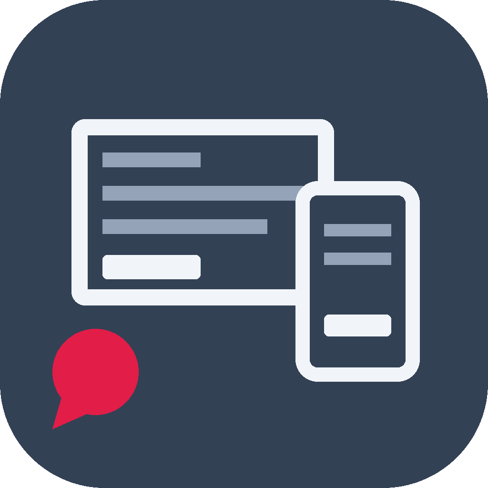
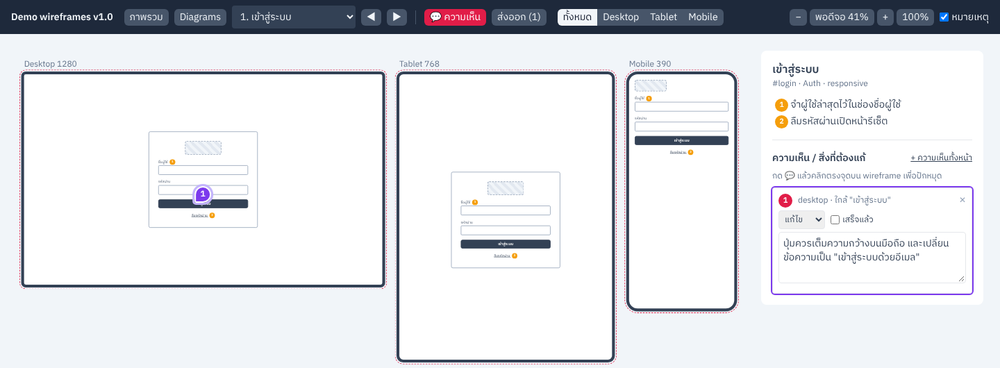
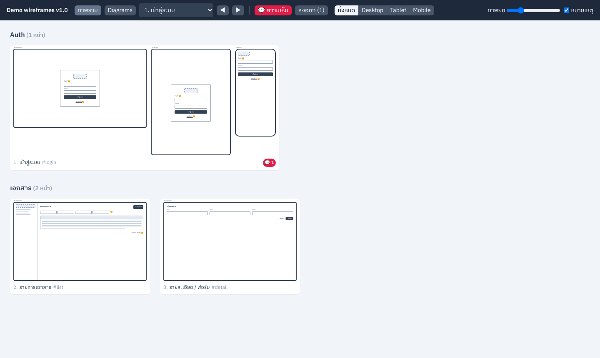
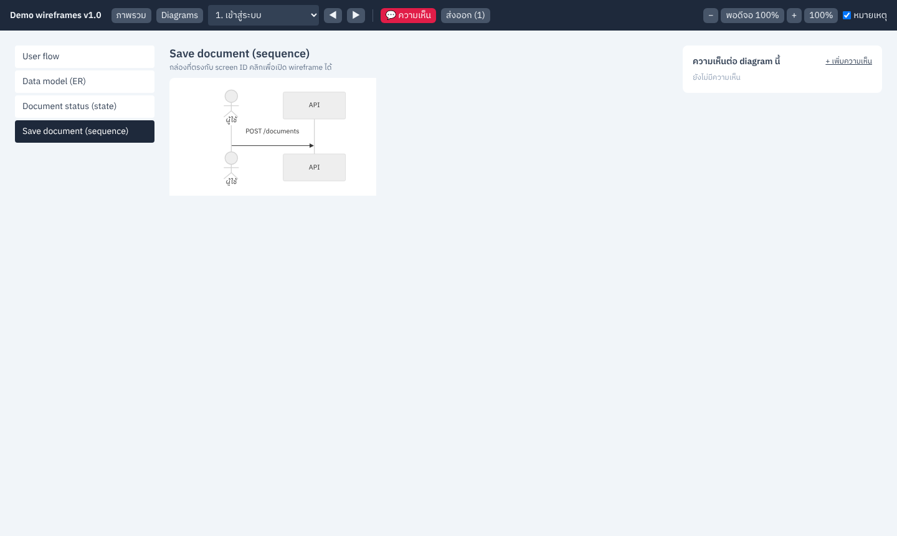

<p align="center">
  
</p>

<h1 align="center">Design Kit — a skill</h1>

<p align="center">
  เล่าว่าจะทำแอปอะไร แล้วได้โปรเจกต์ออกแบบที่รีวิวได้ครบชุด: wireframe ทุกหน้า, mockup ที่คลิกได้,
  design system, diagram สำหรับ dev และ UX spec — แก้อะไรก็อัปเดตทุกไฟล์ให้ตรงกัน
</p>

<p align="center">
  <a href="https://kpv2004.github.io/design-kit/">เอกสารเว็บ (ไทย/EN)</a> ·
  <a href="README.md">English</a> ·
  <a href="#ติดตั้ง">ติดตั้ง</a> ·
  <a href="#อัปเดต-skill">อัปเดต</a> ·
  <a href="#ai-agent-อื่น">AI agent อื่น</a> ·
  <a href="#วิธีใช้">วิธีใช้</a> ·
  <a href="#สิ่งที่ได้">สิ่งที่ได้</a> ·
  <a href="#ขั้นตอนรีวิว">ขั้นตอนรีวิว</a>
</p>



## ทำไมต้องใช้

ถ้าสั่ง AI ว่า "ออกแบบหน้าจอให้หน่อย" ส่วนใหญ่จะได้หน้าสวย ๆ หน้าเดียวที่ไม่เข้าชุดกับหน้าอื่น ใช้ emoji แทน icon ไม่มีหน้าว่างหรือหน้า error และ dev เอาไปทำต่อไม่ได้ skill นี้ทำให้ AI ทำงานเหมือนนักออกแบบที่ส่งงานให้ทีม dev:

- **ครบทุกหน้า** ไม่ใช่แค่ทางที่สำเร็จ รวมถึง login, 403/404, หน้าว่าง, session หมดอายุ
- **มีต้นฉบับเดียว** (`design.md`) สำหรับสี ตัวอักษร และ icon พร้อมตรวจ contrast ตาม WCAG AA
- **ทำ wireframe ก่อน** แล้วค่อยทำ mockup จริง ตกลงโครงสร้างกันก่อนค่อยคุยเรื่องสี
- **มี diagram สำหรับ dev** ทั้ง ER, state, sequence และ API contract ที่ตรงกับหน้าจอ
- **แก้จุดเดียว อัปเดตทุกที่** เช่น "เพิ่มช่องเบอร์โทร" จะแก้ wireframe, mockup, spec, ER และตาราง API พร้อมกัน
- **ตรวจก่อนส่งงาน** มีสคริปต์เช็กว่าทุกไฟล์ตรงกันก่อนส่งมอบ

ใช้ได้กับระบบภายในแบบ ERP / back-office, เว็บแอปสำหรับลูกค้า และแอปมือถือ ผลงานเริ่มต้นเป็นภาษาอังกฤษ แอปที่ localize เอง (เช่นภาษาไทย) จะใช้ภาษาจริงของ UI และเก็บสตริงทุกภาษาไว้ใน copy deck ของ spec — รวมกฎตัวอักษรไทย, รูปแบบบาท และ วว/ดด/ปปปป

## ติดตั้ง

### Claude Code — ผ่าน plugin marketplace (แนะนำ)

ใน session ของ Claude Code:

```
/plugin marketplace add KPV2004/design-kit
/plugin install design-kit@design-kit
```

หรือจาก terminal:

```bash
claude plugin marketplace add KPV2004/design-kit
claude plugin install design-kit@design-kit
```

อัปเดตเป็นเวอร์ชันใหม่:

```bash
claude plugin marketplace update design-kit
claude plugin update design-kit@design-kit
```

ถอนการติดตั้ง: `claude plugin uninstall design-kit@design-kit`

### Claude Code — copy เอง

```bash
git clone https://github.com/KPV2004/design-kit.git
cp -r design-kit/skills/design-kit ~/.claude/skills/design-kit
```

ถ้าต้องการใช้เฉพาะโปรเจกต์เดียว ให้ copy ไปที่ `<โปรเจกต์>/.claude/skills/` แทน

### Claude.ai (เว็บ, desktop, มือถือ)

1. ดาวน์โหลด `design-kit.zip` จาก [release ล่าสุด](https://github.com/KPV2004/design-kit/releases/latest)
   (หรือสร้างเอง: `./tools/build-skill.sh` จะได้ `dist/design-kit.zip`)
2. เปิด **Code execution and file creation** ใน Settings → Capabilities
3. ไปที่ **Customize → Skills** กด **+** → **Create skill** → **Upload a skill** แล้วเลือกไฟล์ zip

skill ที่เปิดใช้บน claude.ai จะ sync ไปที่ Claude Code ด้วยเมื่อ login บัญชีเดียวกัน ดูคู่มือของ Anthropic: [Use skills in Claude](https://support.claude.com/en/articles/12512180)

### AI agent อื่น

skill นี้ใช้รูปแบบเปิด [Agent Skills](https://agentskills.io) (โฟลเดอร์ที่มี `SKILL.md`) จึงใช้กับ agent ตัวไหนก็ได้ที่รองรับ skill เช่น Codex, Gemini CLI, Cursor, GitHub Copilot

**ง่ายที่สุด: ใช้ `skills` CLI** ตัวนี้จะหาว่าในเครื่องมี agent อะไรบ้าง แล้ว copy skill ไปไว้ในโฟลเดอร์ที่ถูกต้องให้แต่ละตัว:

```bash
npx skills add KPV2004/design-kit
```

เลือก agent เองได้ด้วย `-a` เช่น `npx skills add KPV2004/design-kit -a codex -a cursor`

**copy เอง** clone ครั้งเดียว แล้ว copy `skills/design-kit` ไปไว้ในโฟลเดอร์ skills ของ agent:

```bash
git clone https://github.com/KPV2004/design-kit.git
cp -r design-kit/skills/design-kit ~/.agents/skills/design-kit
```

| Agent | ใช้ทุกโปรเจกต์ | เฉพาะโปรเจกต์เดียว |
|---|---|---|
| OpenAI Codex CLI | `~/.agents/skills/` | `.agents/skills/` |
| Gemini CLI | `~/.gemini/skills/` | `.gemini/skills/` |
| Cursor | `~/.cursor/skills/` | `.cursor/skills/` |
| GitHub Copilot (VS Code / CLI) | `~/.copilot/skills/` | `.github/skills/` |
| agent อื่น ๆ | ดูเอกสารของ agent นั้น | หลายตัวอ่าน `.agents/skills/` ได้ |

ชื่อโฟลเดอร์อาจเปลี่ยนตามเวอร์ชันของ agent ถ้า skill ไม่ขึ้นให้เช็กเอกสารของ agent นั้น และเปิด agent ใหม่หลัง copy

**แอปแชตที่ไม่รองรับ skill** (ChatGPT, Gemini เว็บ ฯลฯ): ดาวน์โหลด `design-kit.zip` จาก [release ล่าสุด](https://github.com/KPV2004/design-kit/releases/latest) อัปโหลดเข้าแชต (หรือ project / custom GPT) แล้วสั่งว่า *"ทำตาม SKILL.md ใน zip นี้ ออกแบบ …"* การสร้าง wireframe และ mockup ต้องใช้เครื่องมือที่สร้างไฟล์ได้ และ `verify.py` ต้องรัน Python ได้ ถ้าไม่มีจะได้แค่เนื้อหาการออกแบบเป็นข้อความ

คำสั่งใน skill เขียนและทดสอบกับ Claude โมเดลอื่นทำตามได้ แต่ผลอาจต่างกัน ควรเปิด `wireframes.html` และ `mockup.html` ที่ได้มาตรวจทุกครั้ง

### สิ่งที่ต้องมี

- Python 3.9 ขึ้นไป สำหรับสคริปต์ที่ skill ใช้
- ไม่บังคับ: `pip install playwright && playwright install chromium` เพื่อให้ `verify.py` ตรวจในเบราว์เซอร์ได้ (JS error, ชื่อ icon, syntax ของ Mermaid, หมุดที่มองไม่เห็น) บน claude.ai มีให้อยู่แล้ว
- อินเทอร์เน็ตตอนเปิดไฟล์ HTML (Tailwind, ฟอนต์, icon และ Mermaid โหลดจาก CDN)

## อัปเดต skill

เลือกวิธีตามที่ติดตั้งไว้

### Claude Code — ผ่าน plugin marketplace

ตัว marketplace ดึงจาก GitHub repo นี้ ให้ push โค้ดก่อน แล้วรีเฟรชใน session:

```bash
claude plugin marketplace update design-kit
claude plugin update design-kit@design-kit
```

### Claude.ai (skill ที่อัปโหลด)

สร้าง zip ใหม่ แล้วเปลี่ยนไฟล์ที่อัปโหลดไว้:

```bash
./tools/build-skill.sh          # → dist/design-kit.zip
```

บน claude.ai: **Customize → Skills → design-kit → Delete** แล้ว **Create skill → Upload a skill** ด้วย zip ตัวใหม่

### Copy เอง (Claude Code, Codex, Cursor, agent อื่น)

Copy ทับด้วย `rsync` เพื่อให้ไฟล์ที่ถูกลบหรือเปลี่ยนชื่อใน repo ถูกลบตามด้วย แล้วรีสตาร์ท agent เพราะ skill โหลดตอนเริ่มทำงาน:

```bash
rsync -a --delete --exclude '__pycache__' skills/design-kit/ ~/.claude/skills/design-kit/   # Claude Code แบบ copy เอง
rsync -a --delete --exclude '__pycache__' skills/design-kit/ ~/.agents/skills/design-kit/   # Codex CLI และ agent ส่วนใหญ่
```

ใช้ `cp -r skills/design-kit <ปลายทาง>` ก็ได้ แต่ไฟล์เก่าที่ถูกลบออกจาก repo จะค้างอยู่ ปลายทางให้ชี้ไปที่โฟลเดอร์ skill ของ agent ตัวนั้น (ดูตารางติดตั้งด้านบน เช่น `~/.zcode/skills/` สำหรับ ZCode, `~/.cursor/skills/` สำหรับ Cursor)

### CLI `skills`

```bash
npx skills add KPV2004/design-kit
```

รันซ้ำจะอัปเดตตัวที่มันเคยติดตั้งไว้

### โปรเจกต์ดีไซน์ที่สร้างไว้แล้ว

โปรเจกต์มีสำเนา engine (`_engine/`) และเครื่องมือ (`_tools/`) ของตัวเอง — ไม่อัปเดตตามอัตโนมัติ `verify.py` จะเตือนเมื่อ engine เก่ากว่าเครื่องมือ ให้รันจากในโฟลเดอร์โปรเจกต์:

```bash
python _tools/update_engine.py ~/.claude/skills/design-kit   # หรือ path ที่ติดตั้ง skill ไว้
python _tools/verify.py .
```

สคริปต์จะ copy `_engine/` และ `scripts/` ของ skill ทับสำเนาในโปรเจกต์ ไฟล์ดีไซน์ของคุณไม่ถูกแตะ ถ้าไม่ใส่ path จะค้นหาตำแหน่งติดตั้งที่ใช้กันบ่อยให้ โปรเจกต์ที่สร้างก่อน 1.2.1 ยังไม่มี `update_engine.py` — copy จาก `skills/design-kit/scripts/` ครั้งแรกครั้งเดียว

### ปล่อยเวอร์ชันใหม่

```bash
./tools/release.sh prepare 1.3.0   # เขียนเลข version ทุกที่ ใส่วันที่ใน CHANGELOG และเปิด release PR
./tools/release.sh tag 1.3.0       # หลัง merge: push tag v1.3.0 → workflow สร้าง zip ให้
```

รายละเอียดใน [ร่วมพัฒนา](#ร่วมพัฒนา)

## วิธีใช้

skill จะทำงานเองเมื่อขอให้ช่วยออกแบบ ตัวอย่าง:

```
ออกแบบระบบอนุมัติใบสั่งซื้อสำหรับโรงงาน มีหน้ารายการ รายละเอียด อนุมัติ/ไม่อนุมัติ และ dashboard
ผู้ใช้เป็นพนักงานออฟฟิศที่ใช้ Dynamics AX ทั้งวัน
```

```
ออกแบบแอปจดรายรับรายจ่ายบนมือถือ มีหน้าบันทึก สรุปรายเดือน และตั้งงบประมาณ
```

```
ทำ wireframe portal ให้ลูกค้าใช้เอง: สมัครสมาชิก, login, ดูใบแจ้งหนี้, แจ้งปัญหา
```

ถ้าแอปมีเกินประมาณ 8 หน้า Claude จะส่งรายการหน้าจอ, user flow, ชุดสี และชุด icon ให้ยืนยันก่อน จะได้ไม่ต้องสร้าง 20 หน้าจากสมมติฐานที่ผิด จากนั้นจึงสร้างทั้งหมดและรันการตรวจ

อยากแก้อะไรก็บอกได้เลย เช่น *"เปลี่ยนสีหลักเป็นเขียว"*, *"เพิ่มแบบ Tablet ให้หน้ารายการ"*, *"ตัดหน้า dashboard ออก"* Claude จะแก้ทุกไฟล์ที่เกี่ยวข้องและเพิ่มเลขเวอร์ชันให้

ใน Claude Code เรียกใช้ตรง ๆ ได้ด้วย: `/design-kit:design-kit` ถ้าติดตั้งแบบ plugin หรือ `/design-kit` ถ้า copy เอง

## สิ่งที่ได้

งานแต่ละชิ้นเป็นโฟลเดอร์เดียวที่ใช้ได้ในตัว:

```
<app>-design/
├── AGENTS.md          ให้ AI อ่านก่อน — หน้าที่ของแต่ละไฟล์ กฎการแก้ คำสั่ง (CLAUDE.md โหลดไฟล์นี้)
├── design.md          สี (สว่าง + มืด) ตัวอักษร icon component รายการหน้าจอ changelog
├── ux-spec.md         พฤติกรรม ตาราง state ของทุกหน้า validation + ข้อความ error จริง copy deck diagram (Mermaid) API contract ความเสี่ยง
├── usability-test.md  แผนทดสอบ usability: เป้าหมาย ผู้เข้าร่วม 5 tasks พร้อมหน้าจอ + เกณฑ์สำเร็จ ตัวชี้วัด ผลลัพธ์
├── wireframes.html    ทุกหน้าแบบ low-fi — เปิดในเบราว์เซอร์
├── mock.html          mock แบบ hi-fi ที่คลิกได้ พร้อมเลือก theme — เปิดในเบราว์เซอร์
├── _engine/           โค้ดตัวแสดงผลที่ใช้ร่วมกัน (toolbar, zoom, ความเห็น, กรอบอุปกรณ์)
├── _tools/            verify.py · sync_diagrams.py · export_tokens.py
├── tokens/            tokens.css (รวม dark) · tailwind.config.js · tokens.json (รวม platform mapping เช่นค่าคงที่ Flutter)
└── feedback/          ความเห็นที่ส่งออกจาก wireframe
```

ต้องเปิด `wireframes.html` หรือ `mock.html` จากในโฟลเดอร์ เพราะต้องใช้ `_engine/` ที่อยู่ข้างกัน

### Wireframe

- ดูภาพรวมทุกหน้าแยกตาม module หรือดูทีละหน้า
- เลือกแสดง **Desktop / Tablet / Mobile / ทั้งหมด** (กด `D`) วางเรียงกันในแถวเดียว
- **Zoom** ด้วยปุ่ม `−` `+`, พอดีจอ, 100%, Ctrl/⌘ + scroll หรือ pinch และ **กด Space ค้างแล้วลาก** เพื่อเลื่อน
- **หน้า Diagrams** มี user flow (คลิกกล่องเพื่อไปหน้านั้น), ER, state และ sequence
- **หน้า Components** รวมชุด component `wf-*` แบบขาวดำ (~35 ชิ้น เช่น top bar, sidebar, ตาราง, badge, ฟอร์ม, tabs, stepper, pagination, modal, bottom sheet, toast, skeleton, หน้าว่าง) มีตัวอย่างจริงและปุ่ม **Copy** ทุกชิ้น ทุกหน้าจอสร้างจากชุดนี้ จึงใช้ภาษาภาพเดียวกันทั้งโปรเจกต์





### Mockup

- ดูตัวอย่างแบบ **Desktop / Tablet / Mobile** ได้ โดย breakpoint ของ Tailwind ทำงานจริง
- สลับสถานะได้ (ปกติ / ว่าง / กำลังโหลด / ผิดพลาด) และมี sidebar อธิบายหมุดหมายเลขแต่ละจุด
- **ชุด component** `mk-*` ที่เปลี่ยนตาม theme ได้ (ปุ่ม, ช่องกรอก, ตาราง, badge, tabs, pagination, dialog, alert, toast, skeleton, หน้าว่าง…) ใช้ค่าจาก design tokens มี state hover / focus / disabled / loading / error ในตัว ปุ่มสูง 40px (44px บนจอสัมผัส) รองรับ reduced-motion และสีตัวอักษรผ่าน AA ใน theme มืด
- **ทดสอบด้วยคีย์บอร์ดได้จริง** — ใส่ ARIA role ให้ widget แล้ว engine จะเพิ่มพฤติกรรมคีย์บอร์ดมาตรฐานให้: ลูกศรใน tabs และ menu, `openDialog()` ย้าย focus เข้า ล็อก Tab ปิดด้วย Esc และคืน focus กลับ ส่วน `verify.py` ตรวจ contrast ตัวอักษร ≥ 4.5:1 ทุกหน้าจอในทุก theme
- **หน้า Design system** แสดงทุกสีพร้อมค่า contrast, ขนาดตัวอักษร, ชุด icon และ **แกลเลอรี component** พร้อมโค้ดให้ copy ซึ่งเปลี่ยนตาม theme ทันที

| ตัวอย่างบนมือถือ | Design system |
|---|---|
|  |  |

### สิ่งที่ทำให้งานไม่ดูเป็นงาน AI

- ไม่ใช้ emoji แทน icon และเลือก icon ชุดเดียวให้เหมาะกับผู้ใช้ (Fluent สำหรับคนที่ใช้ Office/Dynamics, Phosphor หรือ Tabler สำหรับงานอื่น ไม่ใช้ Lucide เป็นค่าเริ่มต้น)
- ใช้ icon เสริมข้อความ ไม่ใส่ประดับทุกหัวข้อ ไม่มี sparkles หรือการ์ด icon สีพาสเทลเรียงเป็นตาราง
- ใช้ข้อมูลตัวอย่างที่สมจริงในภาษาของผู้ใช้ ไม่ใช้ lorem ipsum

## ขั้นตอนรีวิว

1. เปิด `wireframes.html` กด **💬** (หรือปุ่ม `C`) แล้วคลิกจุดที่ต้องการปักหมุดความเห็น เลือกประเภทได้ว่า Fix / Add / Remove / Question
2. กด **Export** แล้วคัดลอกหรือดาวน์โหลดเป็น markdown
3. วางในแชตกับ Claude (หรือใส่ไว้ในโฟลเดอร์ `feedback/` แล้วสั่ง Claude Code ให้แก้ตาม)

Claude จะหาจุดที่ปักหมุดไว้ แก้ทุกไฟล์ที่เกี่ยวข้อง ตอบคำถาม และรายงานผลเป็นรายข้อ ความเห็นถูกเก็บไว้ในเบราว์เซอร์แยกตามไฟล์ ควรส่งออกก่อนย้ายหรือเปลี่ยนชื่อโฟลเดอร์

## โครงสร้าง repo

```
.claude-plugin/
  plugin.json            ข้อมูล plugin
  marketplace.json       ทำให้ติดตั้งด้วย /plugin marketplace add ได้
  icon.png
skills/design-kit/   ตัว skill (ส่วนที่ถูกติดตั้ง)
  SKILL.md               ขั้นตอนการทำงานสำหรับ Claude
  references/            สี, icon, pattern ของ ERP/เว็บ/มือถือ, dev diagram, accessibility
  assets/project/        template โปรเจกต์ (ไฟล์เนื้อหา + _engine/)
  scripts/               verify.py, sync_diagrams.py, export_tokens.py
examples/procura-design/ โปรเจกต์ดีไซน์เต็มรูปแบบที่สร้างด้วย skill — ใช้เป็นชุดทดสอบและ live demo บนหน้า docs
tests/                   unit test (สคริปต์) และ browser test (engine, contrast ทุก theme)
tools/
  check.sh               ทุกอย่างที่ CI รัน
  release.sh             เตรียม / tag release
  build-skill.sh         สร้าง dist/design-kit.zip สำหรับ claude.ai
docs-site/               หน้าเว็บ GitHub Pages (kpv2004.github.io/design-kit)
.github/workflows/       ci (ทุก PR) · release (tag vX.Y.Z → zip) · docs (Pages)
```

## ร่วมพัฒนา

ยินดีรับ issue และ pull request ถ้า fork ไปเผยแพร่เอง ให้รัน `./tools/set-owner.sh <github-user> "<ชื่อคุณ>"` ครั้งเดียวเพื่อใส่ลิงก์ติดตั้งและข้อมูลใน manifest

ก่อนเปิด PR ให้รันชุดเดียวกับที่ CI รัน:

```bash
pip install playwright && playwright install chromium   # ครั้งแรกครั้งเดียว
./tools/check.sh                                        # หรือ --fast เพื่อข้าม browser test
claude plugin validate .                                # ตรวจ manifest และ marketplace
```

`check.sh` รัน unit test, `verify.py` กับ `examples/procura-design`, browser test กับ template และตัวอย่าง (ไม่มี JS error, ตัวสลับ State แสดงทีละแบบ, ตัวอักษรทุกจุด ≥ 4.5:1 ทุก theme ทั้งจอ desktop และมือถือ) แล้ว build zip ถ้าแก้ `_engine/` หรือ `scripts/` ให้อัปเดตตัวอย่างด้วย `cd examples/procura-design && python3 _tools/update_engine.py ../../skills/design-kit` — CI จะไม่ผ่านถ้าสำเนาไม่ตรงกัน และเพิ่มบรรทัดใต้ `## Unreleased` ใน `CHANGELOG.md`

**การออก release** ใช้ 2 คำสั่ง ให้เข้ากับการทำงานผ่าน PR:

```bash
./tools/release.sh prepare 1.3.0   # บน main ที่อัปเดตล่าสุด
# merge release PR บน GitHub แล้ว:
git switch main && git pull
./tools/release.sh tag 1.3.0
```

`prepare` จะไม่ยอมรับเลขที่ไม่ใช่รูปแบบ `X.Y.Z` หรือไม่มากกว่าเวอร์ชันปัจจุบัน แล้วเขียนเลขลง `plugin.json`, `_engine/VERSION`, `verify.py` และหน้า docs ใส่วันที่ให้ `## Unreleased` รันการตรวจ และเปิด PR ส่วน `tag` จะสร้าง tag เฉพาะเมื่อ `main` เป็นเลขนั้นแล้ว และ Release workflow รับเฉพาะ tag รูปแบบ `vX.Y.Z`

## License

[MIT](LICENSE)
