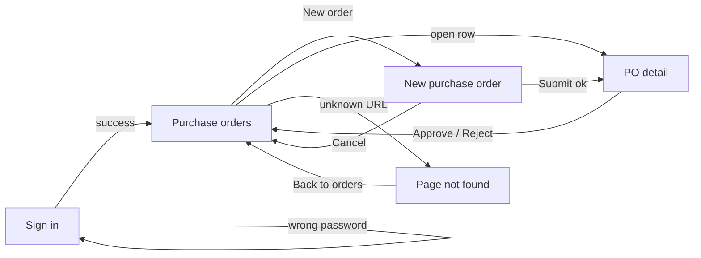
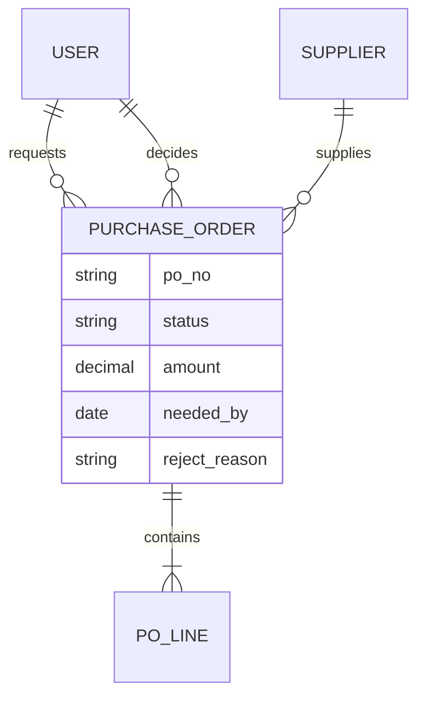
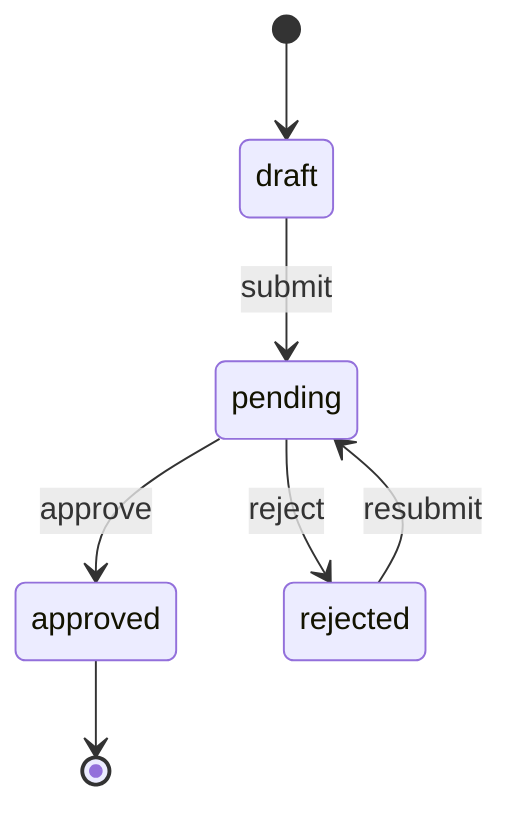
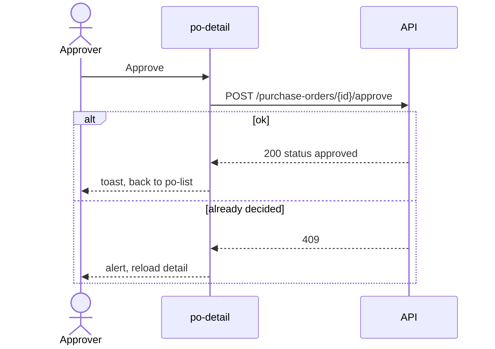

# Procura — UX Spec
> Version 1.1 — matches design.md 1.1
> **This spec must stand alone.** A developer implements from it without reopening app code.

## Summary
Procura lets requesters raise purchase orders (POs) and approvers approve or reject them. Success metric: median time from submit to decision < 4 working hours; approval task completion on mobile ≥ 95% in usability tests.

## Assumptions & open questions
- Approval limit 500,000 THB per approver; above that a second approver is needed (out of scope v1 — shown as an info alert only).
- Open: should rejected POs be editable and resubmitted, or cloned? v1 assumes **edit and resubmit**.

## User flow

## Roles & permissions
### Roles
| Role | Description |
|---|---|
| guest | not signed in — sign-in and system screens only |
| requester | raises purchase orders; edits own orders while draft or rejected |
| approver | approves or rejects pending orders up to 500,000 THB |

### Permission matrix
| Role | Screen | View | Create | Edit | Approve | Delete |
|---|---|---|---|---|---|---|
| * | not-found | ✅ | — | — | — | — |
| guest | login | ✅ | — | — | — | — |
| requester | po-list | ✅ (own orders) | — | — | — | — |
| requester | po-detail | ✅ (own orders) | — | ✅ (while draft or rejected) | — | — |
| requester | po-form | ✅ | ✅ | — | — | — |
| approver | po-list | ✅ | — | — | — | — |
| approver | po-detail | ✅ | — | — | ✅ (while pending, ≤ 500,000 THB) | — |
| approver | po-form | — | — | — | — | — |

Delete is not offered in v1 — rejected orders are edited and resubmitted. Signed-in users opening `login` are redirected to `po-list`.

## Screens

### [login] Sign in
- **Purpose:** authenticate with company username and password.
- **Layout:** centered 384px card on desktop/tablet; full-width form with 20px padding on mobile.
- **Key components:** text field, password field, primary button, ghost link.
- **Behavior:**
  - Focus & input: autofocus Username; prefilled with the last username used on this device.
  - Primary action: success → `po-list`; failure → stay, error alert above the form, password cleared and focused.
  - Button shows `aria-busy` "Signing in…" while the request runs.
- **Annotations:** (1) last username remembered on this device (2) Forgot password opens the IT self-service portal in a new tab.

### [po-list] Purchase orders
- **Purpose:** find a PO and act on it; approvers land on "Pending" by default.
- **Layout:** from `lg` sidebar 240px + table; `md` to `lg` sidebar collapses to the top app bar, table keeps 4 columns (Owner hidden); below `md` rows become cards (PO no. + status on line 1, supplier on line 2, amount right-aligned). Filter chips scroll horizontally on mobile.
- **Key components:** search field, status chips, table/cards, badges, pagination.
- **Behavior:**
  - Search filters by PO no. or supplier after 300 ms debounce; Enter searches immediately.
  - Chips are single-select; "All" clears the status filter. Filters persist in the URL query.
  - Pagination server-side, 50 rows per page.
- **Annotations:** (1) status chips — approvers default to Pending (2) amounts right-aligned, tabular figures (3) server-side pagination, 50 per page.

### [po-detail] Purchase order detail
- **Purpose:** decide on a PO in one view.
- **Layout:** header (PO no., status, amount) then tabs Details / Line items / History. Desktop: action bar top-right; mobile: Approve/Reject in a sticky bottom bar.
- **Behavior:**
  - Approve: no confirmation (reversible by admin), toast "PO-… approved", return to `po-list`.
  - Reject: dialog with required reason; confirm button "Reject order". On success toast + return to list.
  - Edit is only visible to the requester while status is draft or rejected.
- **Annotations:** (1) amount, supplier and status always visible together (2) reject requires a reason, shown to the requester.

### [po-form] New purchase order
- **Purpose:** create and submit a PO.
- **Layout:** single column max 768px; sticky footer with Cancel / Save draft / Submit.
- **Behavior:**
  - Autofocus Supplier picker. Amount uses decimal keyboard and formats with thousands separators on blur.
  - Submit: success → `po-detail` with toast "Submitted for approval"; failure → stay, inline errors, values kept, focus first invalid field.
  - Save draft has no validation except supplier.
- **Annotations:** (1) error text below the field, from the Fields table.

### [not-found] Page not found
- **Purpose:** recover from a bad link.
- **Layout:** centered message + one primary button.
- **Annotations:** none.

## Acceptance criteria
| ID | Screen | Req ID | Given | When | Then |
|---|---|---|---|---|---|
| AC-01 | login | R1 | a user on Sign in | they enter a valid username and password and press Sign in | Purchase orders opens |
| AC-02 | login | R1 | a user on Sign in | they press Sign in with a wrong password | "Username or password is incorrect." shows above the form, the password is cleared and focused |
| AC-03 | po-list | R2 | an approver with 3 pending orders | they open Purchase orders | the Pending chip is selected and 3 rows show |
| AC-04 | po-list | R2 | a requester with no orders | they open Purchase orders | "No purchase orders yet" shows with a New order button |
| AC-05 | po-form, po-detail | R3 | a requester on New purchase order with every field valid | they press Submit for approval | PO detail opens with status Pending and the toast "Submitted for approval" |
| AC-06 | po-form | R3 | a requester enters amount 0 | they press Submit for approval | "Enter an amount above 0." shows under Amount, nothing is saved and focus moves to Amount |
| AC-07 | po-detail, po-list | R4 | an approver on a pending order | they press Approve | Purchase orders opens, the toast "PO-… approved" shows and the row status is Approved |
| AC-08 | po-detail | R4 | an approver in the reject dialog with a 3-character reason | they press Reject order | "Tell the requester why (at least 5 characters)." shows and the dialog stays open |
| AC-09 | po-detail | R4 | a requester opens their own pending order | the detail loads | Approve and Reject are not shown |
| AC-10 | not-found | — | a signed-in user | they open an unknown URL | "We can't find that page" shows; Back to orders opens Purchase orders |

## States
| Screen | Empty | Loading | Error | Success | Permission |
|---|---|---|---|---|---|
| login | n/a | button aria-busy "Signing in…" | alert "Username or password is incorrect." | → po-list | n/a |
| po-list | "No purchase orders yet" + New order CTA; filtered: "No orders match these filters" + Clear filters | 3 skeleton rows | danger alert + Retry | n/a | approvers don't see New order |
| po-detail | n/a | skeleton header + tabs | danger alert + Retry | toast after approve/reject | non-approver: no Approve/Reject |
| po-form | n/a | Submit aria-busy | inline field errors + top alert on 5xx | → po-detail + toast | approvers can't create |
| not-found | n/a | n/a | n/a | n/a | n/a |

## Fields & validation
| Screen | Field | Type | Required | Rule | Error message (exact wording) |
|---|---|---|---|---|---|
| login | username | text | yes | non-empty | "Enter your username." |
| login | password | password | yes | non-empty | "Enter your password." |
| po-form | supplier_id | picker | yes | existing active supplier | "Choose a supplier." |
| po-form | cost_center | select | yes | one of the user's cost centers | "Choose a cost center." |
| po-form | amount | decimal | yes | > 0 and ≤ 10,000,000 | "Enter an amount above 0." |
| po-form | needed_by | date dd/MM/yyyy | yes | today or later | "Choose today or a later date." |
| po-form | note | text | no | ≤ 500 chars | "Keep the note under 500 characters." |
| po-detail | reject_reason | text | yes | 5–500 chars | "Tell the requester why (at least 5 characters)." |

## Interactions & behavior
| Screen | Trigger | Behavior |
|---|---|---|
| po-list | row click / Enter on focused row | open po-detail |
| po-list | status chip | refetch page 1, update URL query |
| po-detail | Approve success | toast "PO-… approved", navigate to po-list, row status updates |
| po-detail | Reject (409 already decided) | dialog closes, alert "Another approver already decided this order.", detail reloads |
| po-form | Submit success | navigate to po-detail, toast "Submitted for approval" |
| po-form | Cancel with unsaved changes | confirm "Discard this order?" |

## Copy deck
| Key | Screen | EN | TH | Notes |
|---|---|---|---|---|
| login.title | login | Sign in to Procura | เข้าสู่ระบบ Procura | |
| login.error | login | Username or password is incorrect. | ชื่อผู้ใช้หรือรหัสผ่านไม่ถูกต้อง | |
| list.title | po-list | Purchase orders | ใบสั่งซื้อ | |
| list.empty.title | po-list | No purchase orders yet | ยังไม่มีใบสั่งซื้อ | |
| list.error | po-list | Couldn't load orders — check your connection | โหลดรายการไม่สำเร็จ — ตรวจสอบการเชื่อมต่อ | |
| detail.approve | po-detail | Approve | อนุมัติ | |
| detail.reject | po-detail | Reject | ไม่อนุมัติ | |
| detail.reject.title | po-detail | Reject {poNo}? | ไม่อนุมัติ {poNo}? | |
| form.submit | po-form | Submit for approval | ส่งขออนุมัติ | |
| notfound.title | not-found | We can't find that page | ไม่พบหน้านี้ | |

## Formats & locale
UI language English; amounts in THB; dates Gregorian.
| Type | Locale | Pattern | Example | Notes |
|---|---|---|---|---|
| date | en-GB | dd/MM/yyyy | 24/11/2026 | needed_by; API sends ISO 8601 `2026-11-24` |
| time | en-GB | HH:mm (24 h) | 14:05 | history tab |
| datetime | en-GB | dd/MM/yyyy HH:mm | 24/11/2026 14:05 | history tab |
| timezone | all | Asia/Bangkok, stored in UTC | — | zone not shown — all users in Thailand |
| number | en-GB | #,##0 | 1,250 | line quantities, tabular-nums |
| currency | en-GB | #,##0.00 THB | 48,500.00 THB | right-aligned; tables omit "THB" in cells, column header says "Amount (THB)" |
| plural | en | one / other | 1 order · 12 orders | result count |

## Dev diagrams
### Data model (ER)

### PO status (state)

### Approve purchase order (sequence)

## API contract
| Method | Path | Used by (screen ID) | Request body | Response | Errors (status → message shown) |
|---|---|---|---|---|---|
| POST | /auth/login | login | `{ username, password }` | 200 → `{ token, user }` | 401 → "Username or password is incorrect." |
| GET | /purchase-orders?status&q&page | po-list | — | 200 → `{ items, total }` | 5xx → "Couldn't load orders — check your connection" |
| GET | /purchase-orders/{id} | po-detail | — | 200 → purchase order | 404 → not-found |
| POST | /purchase-orders | po-form | `{ supplier_id, cost_center, amount, needed_by, note, submit }` | 201 → purchase order | 422 → field errors |
| POST | /purchase-orders/{id}/approve | po-detail | — | 200 → purchase order | 409 → "Another approver already decided this order." |
| POST | /purchase-orders/{id}/reject | po-detail | `{ reject_reason }` | 200 → purchase order | 409 → same as approve |

## Accessibility
| Screen | Announce (aria-live) | Focus on open | Focus return | Tab order |
|---|---|---|---|---|
| login | assertive: "Username or password is incorrect." | Username field | after a failed sign-in: Password field | username → password → Sign in → Forgot password |
| po-list | polite: "12 orders" after a search or chip change | h1 "Purchase orders" | back from po-detail: the row that was opened | side nav → search → status chips → New order → table rows → pagination |
| po-detail | polite: "PO-… approved" toast · assertive: "Another approver already decided this order." | h1 PO number | reject dialog closes → Reject button | breadcrumb → Approve → Reject → tabs → tab panel |
| po-form | assertive: error summary on a failed submit | Supplier picker | after a failed submit: first invalid field · discard confirm closes → Cancel | supplier → cost center → amount → needed by → note → Cancel → Save draft → Submit |
| not-found | n/a | h1 "We can't find that page" | n/a | Back to orders |

### Global
- Status badges carry text + dot; never color alone. Table rows are links with visible focus.
- Reject dialog traps focus and Esc closes it.
- Targets: 40px controls, 44px on touch (mobile sticky action bar) — above the 24×24 px WCAG 2.2 minimum.
- Usable at 200% zoom; at 320px width the card list reflows without horizontal scroll.
- The sticky form footer and mobile action bar never cover the focused field (scroll padding = bar height).
- Honour `prefers-reduced-motion` (motion tokens export as 0ms).

## Risks for implementation
- Concurrent decisions by two approvers → handled by 409; needs server-side status check.
- Table-to-card switch at `md` (768px) must keep row order and keyboard access.
