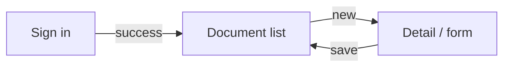
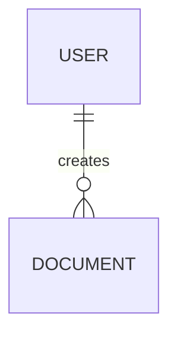
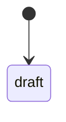

# [App] — UX Spec
> Version 1.0 — matches design.md 1.0
> **This spec must stand alone.** A developer implements from it without reopening app code — anything they must know (behavior, exact error text, endpoints, dark theme, edge cases) lives in these tables, never only in a wireframe annotation. When designing for an existing codebase, extract the facts first (validators, error strings, API client, theme/l10n files) and paste them here verbatim.

## Summary

## Assumptions & open questions

## User flow

## Screens
One `### [id]` heading per inventory screen (several IDs may share a heading). Every `.anno` marker in the wireframe/mockup must have a matching entry in a table below — annotations are pointers, these tables are the source of truth.

### [screen-id] Screen name
- **Purpose:**
- **Layout:** including every responsive rule a dev must implement (e.g. "hide the column-header row below 520px", "table becomes cards on mobile") — never breakpoint details only in an annotation
- **Key components:**
- **Behavior:** the things code would otherwise have to answer
  - Focus & input: autofocus? keyboard type (decimal / email / phone), input formatters (currency grouping, dd/MM/yyyy)
  - Primary action: on success — pop back, navigate, or stay + toast? on failure — stay, and where the error shows
  - Optimistic updates: does the list change immediately or after the request returns?
  - Auto-save vs explicit save: is there a Save button at all? what triggers persistence?
- **Annotations:** (1) … (2) … — match the `.anno` markers in wireframe and mockup

## States
State matrix — every screen that shows data gets a row. Write "n/a" where a state doesn't apply; don't leave states only in annotations.

| Screen | Empty | Loading | Error | Success | Permission |
|---|---|---|---|---|---|
| list | first use: "No documents yet" + CTA | skeleton rows | banner + Retry | — | viewer: read-only |

## Fields & validation
Exact error wording — developers paste it verbatim into the UI and register each string in the copy deck. If the app already has the strings in code, use those, not paraphrases.

| Screen | Field | Type | Required | Rule | Error message (exact wording) |
|---|---|---|---|---|---|
| form | amount | decimal | yes | > 0 | "Enter an amount greater than 0." |

## Interactions & behavior
Cross-screen behavior that a wireframe can't show. If a hidden quirk exists (auto-save, optimistic update, read-only mode), it gets a row here.

| Screen | Trigger | Behavior |
|---|---|---|
| form | Save success | pop back to the list, highlight the new row |
| form | Save fails (409) | stay on the form, inline error, values kept |

## Copy deck
Every UI string with exact wording per locale (use the app's real locales, e.g. EN + TH). Strings live here — not scattered across screens or code.

| Key | Screen | EN | TH | Notes |
|---|---|---|---|---|
| list.empty.title | list | No documents yet | ยังไม่มีรายการ | reused on the dashboard |

## Dev diagrams
### Data model (ER)

### Document status (state)

### Save document (sequence)

## API contract
Method, path, request/response fields and errors — copied from the existing API client when there is one, never invented silently. Endpoint paths, status names and field names must match the ER diagram, state diagrams, and Fields table exactly.

| Method | Path | Used by (screen ID) | Request body | Response | Errors (status → message shown) |
|---|---|---|---|---|---|
| POST | /documents | form | `{ name, amount }` | 201 → document | 409 → "Already posted by another user" |

## Accessibility notes

## Risks for implementation
