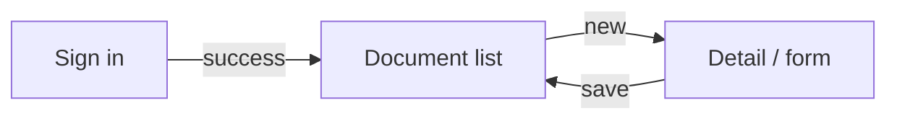
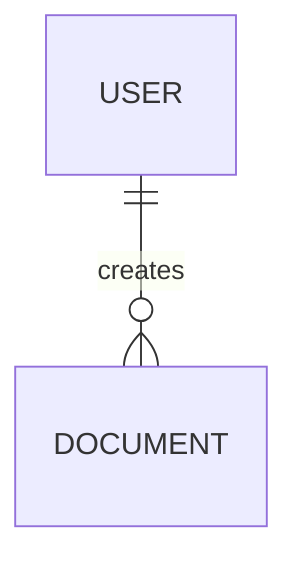
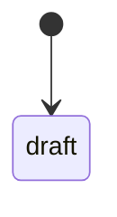

# [App] — UX Spec
> Version 1.0 — matches design.md 1.0
> **This spec must stand alone.** A developer implements from it without reopening app code — anything they must know (behavior, exact error text, endpoints, dark theme, edge cases) lives in these tables, never only in a wireframe annotation. When designing for an existing codebase, extract the facts first (validators, error strings, API client, theme/l10n files) and paste them here verbatim.

## Summary

## Assumptions & open questions

## Users & jobs
Who the design is for and what they are trying to get done. Personas use the roles from Roles & permissions; every job and journey step points to a screen, so a design decision can be traced to a person and a task. Delete this section only for a tiny internal feature. See `references/users-and-journeys.md`.

### Personas
| Persona | Role | Context | Goals | Pain points |
|---|---|---|---|---|
| busy-user | user | uses the app a few times a day, often on a phone | finish a task in under a minute | has to re-enter the same data every time |

### Jobs to be done
| ID | Persona | When | I want to | So I can | Screen |
|---|---|---|---|---|---|
| JTBD-01 | busy-user | a new request comes in | create a document from it quickly | reply the same day | form |

### Journey
One row per stage. `Screen` is `—` for steps outside the app (an email, a phone call). Pain point and Opportunity may be `—`.
| Stage | Persona | Action | Screen | Pain point | Opportunity |
|---|---|---|---|---|---|
| Start | busy-user | signs in | login | forgets the password often | remember the username on this device |
| Find | busy-user | looks for an earlier document | list | — | search by number or name |
| Create | busy-user | fills in a new document | form | long form on a phone | sensible defaults, one column |

## User flow

## Roles & permissions
Who may do what on each screen. `verify.py` checks every role and screen ID. Role keys are lowercase kebab-case; an app without separate rights uses one role `user` (plus `guest` if screens exist before sign-in).

### Roles
| Role | Description |
|---|---|
| guest | not signed in — auth and system screens only |
| user | signed-in user |

### Permission matrix
`Screen` takes one ID, several comma-separated, or `*` (every screen); `Role` takes a declared role or `*` (every role). Cells: `✅` · `✅ (condition)` · `—` (not allowed). View `—` means the screen shows its permission state from the States table (403 or redirect), not just a hidden menu item.
| Role | Screen | View | Create | Edit | Approve | Delete |
|---|---|---|---|---|---|---|
| guest | login | ✅ | — | — | — | — |
| user | list, detail | ✅ | — | — | — | — |
| user | form | ✅ | ✅ | ✅ (own only) | — | — |

## Screens
One `### [id]` heading per inventory screen (several IDs may share a heading). Every `.anno` marker in the wireframe/mockup must have a matching entry in a table below — annotations are pointers, these tables are the source of truth.

### [screen-id] Screen name
- **Purpose:**
- **Layout:** including every responsive rule a dev must implement, named by the design.md §4.2 breakpoints (e.g. "table becomes cards below `md`", "sidebar shown from `lg`") — never breakpoint details only in an annotation
- **Key components:**
- **Behavior:** the things code would otherwise have to answer
  - Focus & input: autofocus? keyboard type (decimal / email / phone), input formatters (currency grouping, dd/MM/yyyy)
  - Primary action: on success — pop back, navigate, or stay + toast? on failure — stay, and where the error shows
  - Optimistic updates: does the list change immediately or after the request returns?
  - Auto-save vs explicit save: is there a Save button at all? what triggers persistence?
- **Annotations:** (1) … (2) … — match the `.anno` markers in wireframe and mockup

## Acceptance criteria
One table for the whole app — QA writes tests from it. Every inventory screen appears in at least one row. **ID**: `AC-01`, `AC-02`… (unique, never reused). **Screen**: one ID or several comma-separated. **Req ID**: from the inventory, or `—`. **Then** must be observable (text on screen, saved value, screen reached); for errors, quote the exact error text from Fields & validation.

| ID | Screen | Req ID | Given | When | Then |
|---|---|---|---|---|---|
| AC-01 | login, list | R1 | a user with a valid account | they sign in | Documents opens |
| AC-02 | list, detail | R2 | a user with 3 documents | they open the first row | its detail opens |
| AC-03 | form | R3 | the amount is 0 | the user presses Save | "Enter an amount greater than 0." shows under the field and nothing is saved |

## States
State matrix — every screen that shows data gets a row. Write "n/a" where a state doesn't apply; don't leave states only in annotations.

| Screen | Empty | Loading | Error | Success | Permission |
|---|---|---|---|---|---|
| list | first use: "No documents yet" + CTA | skeleton rows | banner + Retry | — | viewer: read-only |

## Fields & validation
Exact error wording — developers paste it verbatim into the UI and register each string in the copy deck. If the app already has the strings in code, use those, not paraphrases.

| Screen | Field | Type | Required | Rule | Error message (exact wording) |
|---|---|---|---|---|---|
| form | amount | decimal | yes | > 0 | "Enter an amount greater than 0." |

## Interactions & behavior
Cross-screen behavior that a wireframe can't show. If a hidden quirk exists (auto-save, optimistic update, read-only mode), it gets a row here.

| Screen | Trigger | Behavior |
|---|---|---|
| form | Save success | pop back to the list, highlight the new row |
| form | Save fails (409) | stay on the form, inline error, values kept |

## Copy deck
Every UI string with exact wording per locale (use the app's real locales, e.g. EN + TH). Strings live here — not scattered across screens or code.

| Key | Screen | EN | TH | Notes |
|---|---|---|---|---|
| list.empty.title | list | No documents yet | ยังไม่มีรายการ | reused on the dashboard |

## Formats & locale
How every date, time, number and currency is shown, per locale. Patterns are CLDR/ICU. Thai UIs state the era (Buddhist พ.ศ. or Gregorian ค.ศ.). APIs exchange ISO 8601 and plain numbers; formatting happens only in the UI.

| Type | Locale | Pattern | Example | Notes |
|---|---|---|---|---|
| date | en-GB | dd/MM/yyyy | 24/11/2026 | |
| date | th-TH | d MMM yyyy (Buddhist era) | 24 พ.ย. 2569 | |
| time | all | HH:mm (24 h) | 14:05 | |
| datetime | all | date + " " + time | 24/11/2026 14:05 | |
| timezone | all | Asia/Bangkok, stored in UTC | — | show the zone only if users span zones |
| number | all | #,##0.## | 1,234.5 | tabular-nums in tables |
| currency | th-TH | #,##0.00 | 50,000.00 | THB; negative -1,200.00 |
| plural | en | one / other | 1 item · 3 items | Thai has no plural forms — one string |

## Notifications
Locales: en, th

Messages sent outside the screens. Backend sends them from these tables: one trigger per event, one copy row per channel × locale. Variables are `{{snake_case}}`, declared with a type on the trigger; no logic (`{{#if}}`, `{%`) in any text. Money and dates are formatted per Formats & locale in the recipient's language. Push is shown on the lock screen — no sensitive data. See `references/content-and-messages.md`.

### Notification triggers
`Trigger` uses the event name from Analytics events. `Recipient`: a declared role, or `actor` (the person who did the action). `Channels`: `email` · `push` · `in-app` · `sms`. `Category`: `transactional` · `marketing` (needs consent + unsubscribe). `Screen`: what the link opens, or `—`.
| ID | Trigger | Recipient | Channels | Category | Screen | Variables |
|---|---|---|---|---|---|---|
| NT-01 | document_submitted | actor | email, in-app | transactional | detail | document_name: string, submitted_at: datetime, action_url: url |

### Notification copy
Email: `Subject / Title` is the subject and `Body` the plain-text summary. Every ID × channel needs every locale listed above.
| ID | Channel | Locale | Subject / Title | Body |
|---|---|---|---|---|
| NT-01 | email | en | {{document_name}} was submitted | Submitted on {{submitted_at}}. Open it: {{action_url}} |
| NT-01 | email | th | ส่ง {{document_name}} แล้ว | ส่งเมื่อ {{submitted_at}} เปิดดู: {{action_url}} |
| NT-01 | in-app | en | Document submitted | {{document_name}} is waiting for review. |
| NT-01 | in-app | th | ส่งเอกสารแล้ว | {{document_name}} รอการตรวจ |

### Channel limits
Recommended maximum characters before most screens cut the text (warnings, not provider limits). Thai tone marks and above/below vowels don't count. Channels/fields without a row aren't checked.
| Channel | Field | Locale | Max chars |
|---|---|---|---|
| email | Subject / Title | all | 60 |
| push | Subject / Title | all | 40 |
| push | Body | all | 120 |
| in-app | Subject / Title | all | 60 |
| in-app | Body | all | 200 |
| sms | Body | th | 70 |
| sms | Body | en | 160 |

## Analytics events
What the product measures. Event names are `object_action` in the past tense (`document_submitted`), snake_case, ≤ 40 characters; screens use one `screen_viewed` event with `screen_id`. Types: `string` · `integer` · `number` · `boolean` · `datetime` · `enum(a/b)` · `string[]`; `name?` marks an optional property. No personal data (names, emails, phone numbers, free text) — use internal IDs. Results that must be exact (saved, approved, paid) are sent by the server. See `references/content-and-messages.md` §Analytics.

### Common properties
Added to every event by the SDK.
| Property | Type | Notes |
|---|---|---|
| user_id | string | internal ID, never an email |
| platform | enum(web/ios/android) | |
| locale | enum(en/th) | |

### Events
| Event | Trigger | Screen | Source | Properties | Req ID |
|---|---|---|---|---|---|
| screen_viewed | the screen has rendered | * | client | screen_id: string | — |
| document_submitted | Save returns 2xx | form | server | document_id: string, amount: number, currency: string | R3 |
| list_filtered | a filter changes | list | client | filter: enum(all/mine), result_count: integer, has_query?: boolean | R2 |

## Charts
Only for apps with charts — **delete this section if the app has none**. One row per chart: the question it answers, the type chosen for that question, the data fields from the API contract response, palette tokens from design.md §2.6, and whether a data table is available. `Type`: `bar` · `grouped-bar` · `stacked-bar` · `line` · `area` · `combo` · `donut` · `kpi` · `progress` · `sparkline` · `scatter` · `table`. See `references/data-viz.md`.

| Chart | Screen | Question | Type | Data | Palette | Table fallback |
|---|---|---|---|---|---|---|
| documents-by-status | list | How many documents wait at each status? | bar | x: status · y: count (count, documents) | chart-1 | yes |

## Dev diagrams
### Data model (ER)

### Document status (state)

### Save document (sequence)

## API contract
Method, path, request/response fields and errors — copied from the existing API client when there is one, never invented silently. Endpoint paths, status names and field names must match the ER diagram, state diagrams, and Fields table exactly.

| Method | Path | Used by (screen ID) | Request body | Response | Errors (status → message shown) |
|---|---|---|---|---|---|
| POST | /documents | form | `{ name, amount }` | 201 → document | 409 → "Already posted by another user" |

## Accessibility
One row per inventory screen (`verify.py` checks). No empty cells — write `n/a`. **Announce**: what a screen reader hears without moving focus, as `polite: …` or `assertive: …` (errors), several joined with ` · `. **Focus on open**: what gets focus when the screen or dialog opens. **Focus return**: where focus goes after a dialog/sheet closes or after Save. **Tab order**: elements joined with `→`.

| Screen | Announce (aria-live) | Focus on open | Focus return | Tab order |
|---|---|---|---|---|
| login | assertive: sign-in error | email field | n/a | email → password → Sign in → Forgot password |
| list | polite: result count after filtering | h1 "Documents" | back from detail: the row that was opened | search → filters → New → table rows → pagination |
| detail | polite: "Saved" toast | h1 document name | dialog closes → the button that opened it | back → actions → content |
| form | assertive: error summary on a failed save | first field | after a failed save: first invalid field | fields in order → Cancel → Save |

### Global
- Target size ≥ 24×24 CSS px (WCAG 2.2 SC 2.5.8); the kit uses 40px, 44px on touch
- Usable at 200% zoom; reflows at 320px width without horizontal scroll (data tables excepted)
- Mobile: layouts hold at the OS's largest text size (dynamic type); no fixed-height text containers
- Honour `prefers-reduced-motion` (motion tokens export as 0ms)
- Status never by color alone — badge text or icon too

## Risks for implementation
