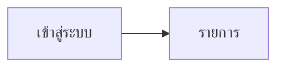
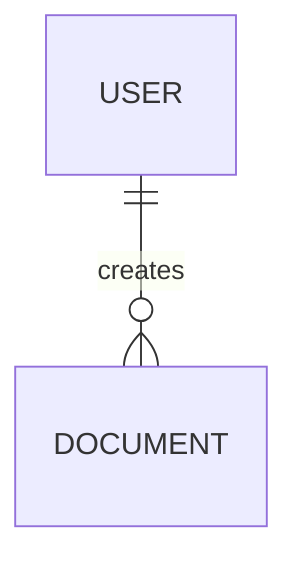
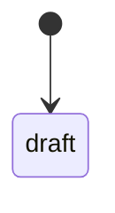
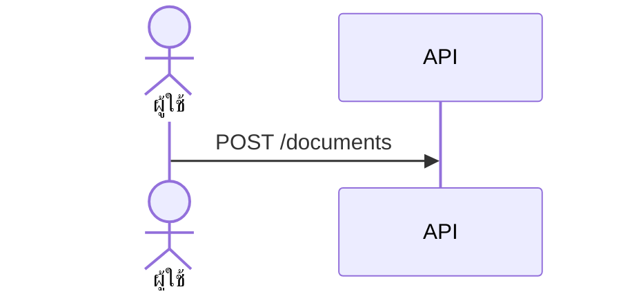

# [App] — UX Spec
> Version 1.0 — matches design.md 1.0

## Summary

## Assumptions & open questions

## User flow

## Screens
### [screen-id] Screen name
- **Purpose:**
- **Layout:**
- **Key components:**
- **Annotations:** (1) … (2) … — match `.anno` markers in wireframe and mockup

## States
| Screen | Empty | Loading | Error | Success | Permission |
|---|---|---|---|---|---|

## Fields & validation
| Field | Type | Required | Rule | Error message (exact wording) |
|---|---|---|---|---|

## Interactions & behavior

## Dev diagrams
### Data model (ER)

### Document status (state)

### Save document (sequence)

## API contract
| Method | Path | Used by (screen ID) | Request | Success | Errors (status → message shown) |
|---|---|---|---|---|---|

## Accessibility notes

## Risks for implementation
