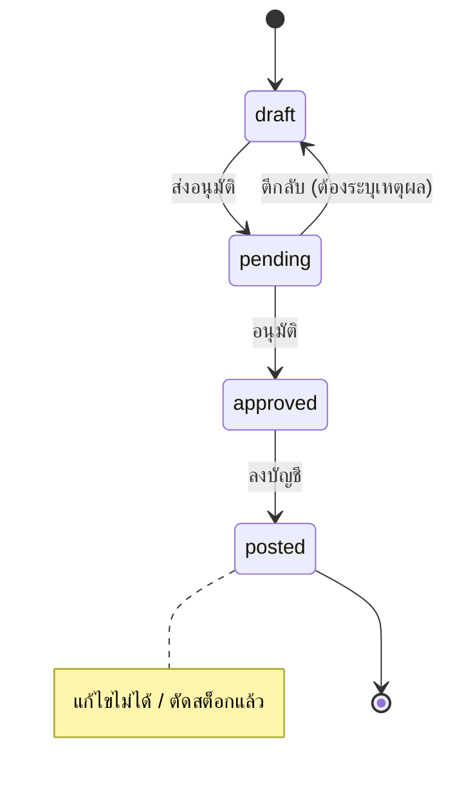
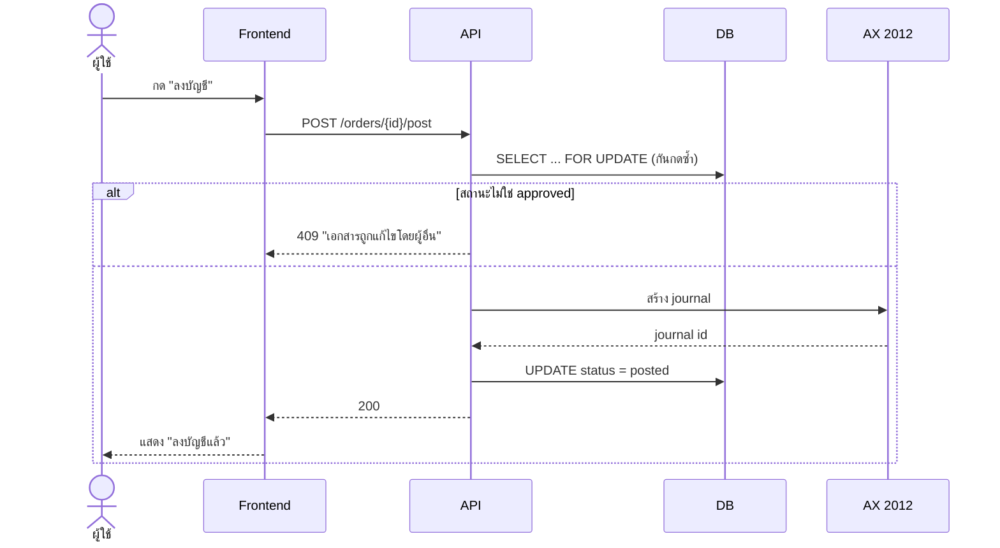
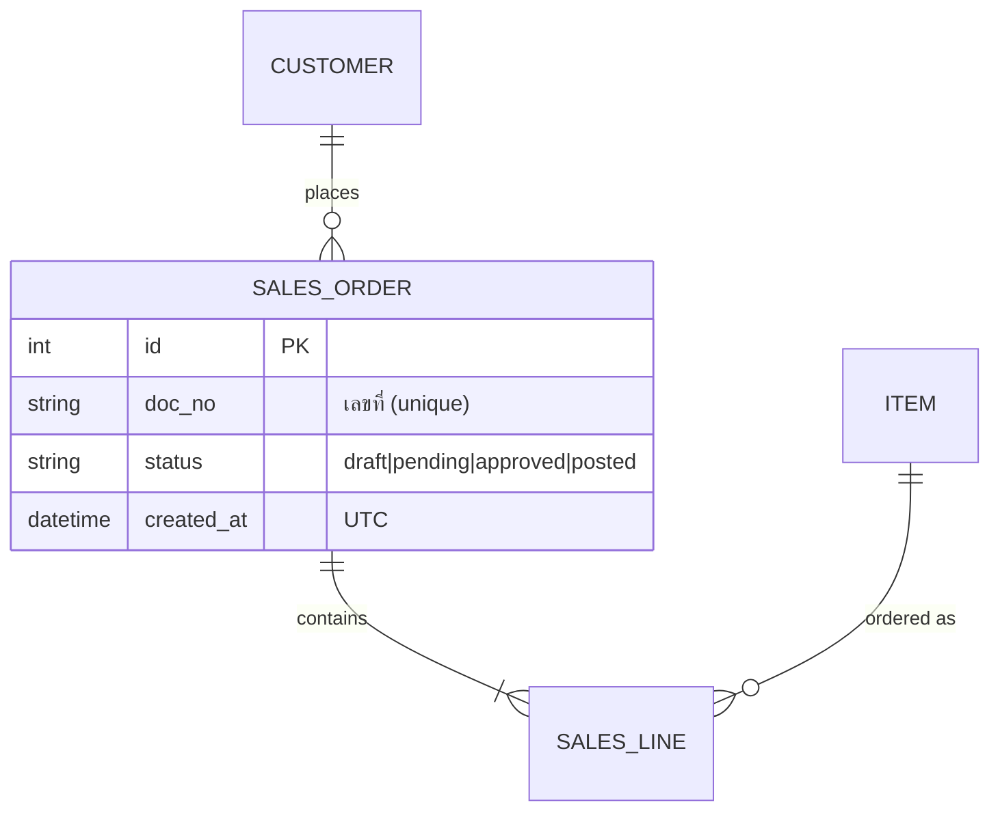

# Dev Diagrams

Diagrams that let a developer build what the wireframes show without guessing. They live in the UX spec under `## Dev diagrams` as ```mermaid blocks (rendered inline by GitHub, Obsidian, VS Code), and `scripts/sync_diagrams.py` copies them into the wireframe's **Diagrams** page so reviewers can comment on them.

## Contents
1. Which diagrams to include
2. Conventions
3. Examples
4. API contract table

## 1. Which diagrams to include

| Diagram | Mermaid | Include when | Answers |
|---|---|---|---|
| **User flow** | `flowchart LR` | Always | Which screen leads where, including failure paths |
| **Data model (ER)** | `erDiagram` | Any screen shows or saves data | Tables, key fields, relationships, cardinality |
| **State lifecycle** | `stateDiagram-v2` | Any entity has a status (document, order, account, ticket) | Allowed transitions, who triggers them, what is locked in each state |
| **Sequence** | `sequenceDiagram` | Each non-trivial action: save/post, approval, login/OTP, payment, import, anything touching an external system | Call order between UI, API, DB, external services; where validation and errors happen |
| **Integration / architecture** | `flowchart LR` with subgraphs | The app talks to other systems (ERP, email, SMS, payment, Kafka, linked server) | Systems, direction of data, sync vs async |
| **Sitemap / navigation** | `flowchart TD` | More than ~15 screens or role-based menus | Menu structure, which role sees which screen |

Minimum for any app with data: User flow + ER + one State per status-bearing entity + one Sequence per main action. Skip a type only if it truly doesn't apply, and say so in the spec.

## 2. Conventions

- **Screen IDs as node IDs** in flowcharts (`po-list[รายการใบสั่ง]`) — the Diagrams page turns them into links to the wireframe.
- **ER**: entity and field names in English as they would be in the database (`PURCHASE_ORDER`, `doc_no`), Thai meaning in the comment string (`string doc_no "เลขที่เอกสาร"`). Mark `PK`, `FK`, and unique fields. If integrating with an existing database, use the real table names.
- **State**: state names = exact status values stored in the DB; transition labels = the button text the user clicks (`pending --> approved : อนุมัติ`). Add `note` for side effects (e.g. stock posted, email sent).
- **Sequence**: participants = `actor User`, `Frontend`, `API`, `DB`, plus each external system. Show the error path with `alt` / `else` blocks. Label API calls as `METHOD /path` matching the API table.
- Keep each diagram under ~25 nodes; split by module if bigger.
- Status values, endpoint paths, and field names must match the spec's Fields table and API table exactly.

## 3. Examples







## 4. API contract table

Put this in the spec right after the diagrams. One row per endpoint used by any screen.

```markdown
## API contract
| Method | Path | Used by (screen ID) | Request | Success | Errors (status → message shown) |
|---|---|---|---|---|---|
| POST | /auth/login | login | email, password, remember | 200 {token} | 401 → "อีเมลหรือรหัสผ่านไม่ถูกต้อง" · 423 → account-locked |
```

The "message shown" column must match the exact error wording in the Fields & validation table.
